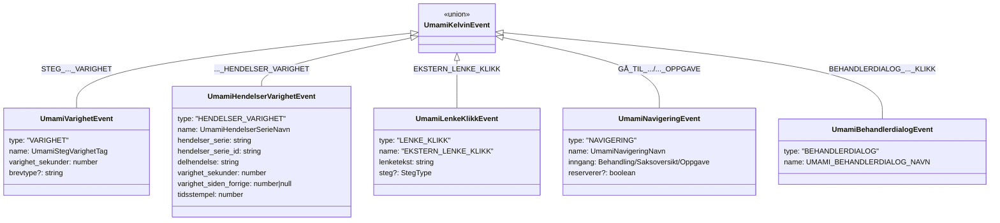

# Umami-hendelsestyper i denne kodebasen

`UmamiKelvinEvent` (`lib/utils/umami/kelvinEvent.ts`) er en diskriminert union på `type`-feltet, med varianter definert i egne filer under `lib/utils/umami/`.

- **`UmamiVarighetEvent`** (`varighet.ts`) — tidsmåling for et behandlingssteg, tag `STEG_<KONTEKST>_VARIGHET`.
- **`UmamiHendelserVarighetEvent`** (`hendelserVarighet.ts`) — serie av tidsmålte delhendelser, tag `<KONTEKST>_HENDELSER_VARIGHET`.
- **`UmamiLenkeKlikkEvent`** (`lenkeKlikk.ts`) — klikk på ekstern lenke, tag `EKSTERN_LENKE_KLIKK`.
- **`UmamiNavigeringEvent`** (`navigering.ts`) — navigasjon/oppgavehandling, tag `GÅ_TIL_<MÅL>` eller `<HANDLING>_OPPGAVE`.
- **`UmamiBehandlerdialogEvent`** (`behandlerdialog.ts`) — brukerinitierte handlinger i dialog med behandler, tag `BEHANDLERDIALOG_<HANDLING>_KLIKK`.

Alle sendes via `clientLoggUmamiEvent` (`client.ts`) → `POST /api/umami` (`app/api/umami/route.ts`) → `@umami/node`.

## Dialog med behandler

`loggUmamiBehandlerdialogKlikk(name)` sender kun hendelsesnavn og type, uten saks- eller personopplysninger:

- `BEHANDLERDIALOG_ÅPNE_SEND_FORESPØRSEL` — innsending av bestilling/dialogmelding etter skjemavalidering.
- `BEHANDLERDIALOG_SEND_FORESPØRSEL` — send purring.
- `BEHANDLERDIALOG_AVBRYT_PÅMINNELSE` — avbryt automatisk påminnelse.
- `BEHANDLERDIALOG_GJENOPPTA_PÅMINNELSE` — gjenoppta automatisk påminnelse.

Hendelsene måler brukerens handling før API-kallet, ikke om kallet lykkes.
